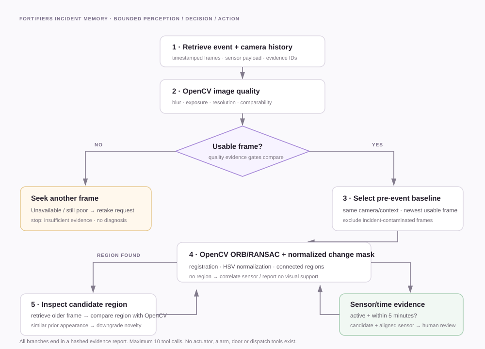

# Agent workflow

The controller is deterministic, bounded and driven by observed OpenCV outputs. The competition's Agentic Vision criteria require OpenCV results to change a subsequent plan, tool call or human-review request; the paths below do so. See the [official Agentic Vision requirement](https://opencv.org/opencv-ai-competition-2026/) and [workflow diagram](submission/agent-workflow.svg).

## State transitions

1. `retrieve_event_frames()` indexes same-camera pre-event history and the event image.
2. `evaluate_image_quality()` computes Laplacian blur, luminance, clipped-pixel fractions and a documented quality score.
3. If unusable, `retrieve_additional_frame()` looks for another historical view. If none exists, `generate_review_request(retake)` stops the investigation as insufficient evidence.
4. Otherwise, `select_historical_baseline()` picks the most recent usable, non-incident frame before the event.
5. `align_and_compare()` registers frames and yields comparability, reliability, illumination gain, candidate regions, masks and geometry.
6. If a candidate exists, `inspect_region()` describes visible color/texture. `retrieve_additional_frame()` asks whether the appearance predates the event. OpenCV pixel comparison in that region can downgrade novelty when the older appearance matches.
7. `correlate_sensor_event()` checks sensor activity and a five-minute timestamp window. A candidate plus aligned sensor yields a *possible visible water change* and mandatory operator review. It never establishes physical presence or root cause.
8. `create_evidence_report()` stores evidence classes, image hashes, the complete trace and the stop condition.

## Expected branches

| Fixture | OpenCV observation | Next action chosen from that observation | Outcome |
|---|---|---|---|
| `clear_change` | Usable frame, one localized cool-toned candidate | Inspect ROI → retrieve older history → correlate sensor → request operator review | Possible visible water change; cause unverified |
| `poor_image` | Blur variance below 24 | Skip comparison → seek another frame → request retake | Insufficient evidence |
| `lighting_shift` | Global brightness offset normalizes; no candidate region | Correlate inactive sensor → report no visual support | No credible visual water evidence |
| `historical_match` | Candidate against latest baseline | Retrieve older frame → compare ROI with OpenCV → downgrade novelty | Similar appearance was previously observed |

Each trace entry includes iteration number, observation inputs, threshold values, selected action, evidence references, result/error, timestamp and stopping condition. The controller has a 10-tool-call cap and an exception path that fails closed. The UI reveals the completed trace for each decision path.

## Safety boundary

Evidence classes are `OBSERVED`, `SENSOR_CORRELATED`, `HYPOTHESIS` and `UNVERIFIED`. “Cool-toned” is a weak appearance descriptor, not a water detector. Standard RGB does not sense invisible gas or establish fire root cause. The controller cannot shut down machinery, open doors, disable alarms or dispatch responders. Significant maintenance/safety choices remain with an operator.

