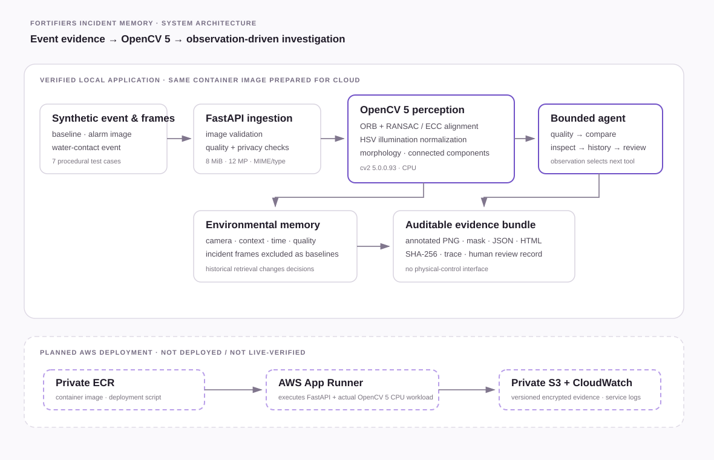

# Architecture

Fortifiers Incident Memory is an event-triggered, bounded visual investigation system. The same FastAPI/OpenCV 5 service runs locally and on AWS Lambda. The verified public AWS deployment is a Python 3.14 ZIP package at commit b851290df9e99aca1a232c018e53bff48b8f559d, with a public Function URL, private S3 evidence retention and CloudWatch logs. See deployment-manifest.json and DEPLOYMENT.md for live checks and resource details.

## Data and trust boundaries

1. A synthetic water-contact event selects a camera and alarm frame. The optional local upload API checks media type, request size, decoded dimensions, color decoding and resolution compatibility. Decoding/re-encoding removes source metadata. OpenCV 5 DNN FaceDetectorYN uses YuNet to blur detected faces; this can miss faces and identifiers. The AWS deployment disables all user uploads.
2. IncidentMemory indexes frames by camera, context and timezone-aware timestamp. It selects a usable pre-event frame and excludes incident-marked frames from baseline selection.
3. OpenCV 5 assesses blur/exposure, attempts ORB feature matching and RANSAC homography, falls back to ECC translation, normalizes brightness in HSV, creates localized change masks, applies morphology and extracts connected-component regions.
4. The bounded controller chooses what to do next from these observations. A candidate can trigger ROI inspection and older-frame retrieval; poor quality requests another frame; a historical match downgrades novelty; sensor timing adds correlation context only.
5. The report separates observed visual changes, sensor correlation, hypothesis and unverified cause. It includes traces, PNGs, SHA-256 hashes and operator review controls. No physical-control interface exists.
6. The AWS Lambda function runs the actual OpenCV API. Evidence ZIPs and review records are stored in a private S3 prefix with a seven-day expiry. Function logs expire after 14 days. The public Function URL exposes only seven synthetic scenarios and disables image uploads. CloudWatch confirms real executions. The reproducible ZIP path is active; provisioned CodeBuild/ECR resources were not used because the account queue quota was zero.

## Components

| Component | Location | Responsibility |
|---|---|---|
| Ingestion and HTTP API | src/incident_memory/api.py | Health, scenarios, safe local image upload, investigation, downloadable artifacts, review capture |
| Environmental memory | src/incident_memory/memory.py | Time/camera/context filtering, duplicate event detection, incident exclusion |
| OpenCV 5 perception | src/incident_memory/vision.py | Decode, quality, registration, illumination normalization, candidate masks and geometry |
| Agent controller | src/incident_memory/agent.py | Bounded observation-driven tool routing and fail-closed reports |
| Reports | src/incident_memory/reports.py | Accessible HTML evidence report |
| Cloud persistence | src/incident_memory/cloud.py | S3 evidence storage and presigned report downloads |
| AWS deployment | deployment/aws-app-zip.yaml; scripts/package_lambda_zip.py | Lambda ZIP package, memory/runtime configuration, public Function URL and scoped IAM |
| Frontend | src/incident_memory/static/ | Responsive scenario dashboard, image slider, trace and human review |
| Evaluation | scripts/evaluate.py; data/synthetic/ | Labeled procedural fixture set and measured comparator |

## Public endpoints

- GET /health — OpenCV version, deployment mode, build and commit.
- GET /api/scenarios — lists synthetic test cases.
- GET /api/investigate/{scenario_id} — runs OpenCV and the adaptive agent path.
- POST /api/investigate/upload — local only; disabled in AWS.
- POST /api/review/{run_id} — records acknowledge/reject/request-more-evidence; no actuation.
- Evidence bundle — generated by the service, stored privately and downloaded through a time-limited signed URL.
