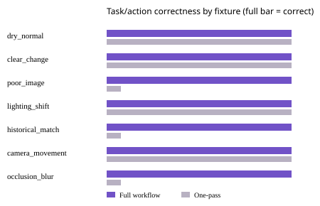

# Evaluation and measured results

## Test material and method

`scripts/build_dataset.py` creates 14 PNG fixture sets (seven scenarios × tuning/held-out split), with baseline, alarm-time image, binary staged-change mask, optional older frame and `data/synthetic/manifest.csv`. The fixed seeds are 26025 for threshold/fixture checks and 26026 for the held-out run. Both use the same procedural scene construction with seeded texture; the second seed is not an independent real-world domain. There are no third-party or customer images.

The held-out script runs the full workflow three times per scenario, seven scenarios total (21 runs). For comparison, a simple one-pass reference runs the same OpenCV detector once on the nearest baseline/current pair and has no quality gate, memory retrieval, sensor policy or agent tool routing. Expected outcomes are explicit scenario rules in `scripts/evaluate.py`; they are not independent human ground truth. Pixel labels mark only the synthetic color-patch polygon.

## Actual results from the recorded run

Environment: Windows 10.0.19045, Python 3.14.0, OpenCV 5.0.0.93 wheel/runtime version 5.0.0, NumPy 2.5.4, four reported logical CPUs. Controller-only timing excludes fixture creation, API response encoding, ZIP/S3 storage and network.

| Measure | Observed |
|---|---:|
| Held-out scenario types | 7 |
| Full-workflow runs | 21 (3 each) |
| Expected action selected | 7/7 (1.000) |
| One-pass reference expected action | 4/7 (0.571) |
| Benign fixture types with a one-pass candidate | 0/4 |
| Unnecessary retake requests | 0/7 |
| Mean tool calls per investigation | 6.714 |
| Controller latency p50 / p95 | 158.477 / 246.465 ms (n=21) |
| Pixel mask precision / recall / F1 | 0.99183 / 0.99913 / 0.99546 |
| Pixel mask IoU | 0.99097 (four 640×480 masks: 1,228,800 pixel positions; 16,170 pixels in prediction/truth union) |
| Process RSS before / after | 34.38 / 61.16 MiB (delta 26.78 MiB; not peak) |
| Process CPU time during run | 6.000 s |

Case-level results are in [artifacts/evaluation-cases.csv](artifacts/evaluation-cases.csv); the machine-readable source is [artifacts/evaluation.json](artifacts/evaluation.json).

| Scenario | Full outcome | Full action correct | One-pass action correct | Calls |
|---|---|---:|---:|---:|
| Dry / normal | No visual change supported | Yes | Yes | 6 |
| Clear synthetic patch + active sensor | Human review required | Yes | Yes | 9 |
| Blurred frame | Retake requested | Yes | No | 5 |
| Global lighting shift | No visual change supported | Yes | Yes | 6 |
| Older matching region | No new change supported | Yes | No | 10 |
| Camera movement | No visual change supported | Yes | Yes | 6 |
| Occlusion + blur | Retake requested | Yes | No | 5 |

## Interpretation and failure cases

The strongest evidence is deterministic branch behavior: blur and occlusion prevent diagnosis; history changes the new-versus-pre-existing action; a uniform lighting change is normalized; and a localized synthetic patch plus a time-aligned synthetic sensor reaches mandatory review. The one-pass comparator mislabels the blurred and history cases because it has no quality/history policy. The mask score is high because the generated patch is visually separable from a procedurally drawn room; it is not a water-classification score.

The 36-test suite also covers corrupt/missing bytes, dimension mismatch, feature-registration fallback, absent baseline, sensor absence, timezone validation, duplicate events, insecure upload type/size, untrusted IDs, fail-closed face-model failure and an S3 failure stub. AWS and Docker tests against actual services were not possible and were not claimed. Initial fixture generation blurred the entire scene, causing the quality gate to reject the positive case; the fixture was corrected to soften only the synthetic patch edge before the recorded evaluation. An initial privacy test also exposed that OpenCV 5 removes the OpenCV 4 `CascadeClassifier` API; it was replaced with OpenCV 5 `FaceDetectorYN` and an upstream YuNet ONNX model. This is an implementation compatibility fix, not a real-world accuracy result. This test-fixture fix is not a real-world accuracy improvement.

### Limits

- Seven held-out scenario templates from one synthetic scene generator; no camera/domain shift estimate.
- Scenario expected outcomes are policy labels set by the test author, not independent expert review.
- Mask precision/recall and IoU are pixel-change overlap, not region localization against real leaks.
- No calibrated probability, physical water sensor integration, actual room, user study, AWS latency, throughput, cost, GPU or Arm measurement.
- RSS values are one before/after sample; not maximum working set.
- No independent test of all browser/OS combinations or Python 3.11/Docker image builds.

