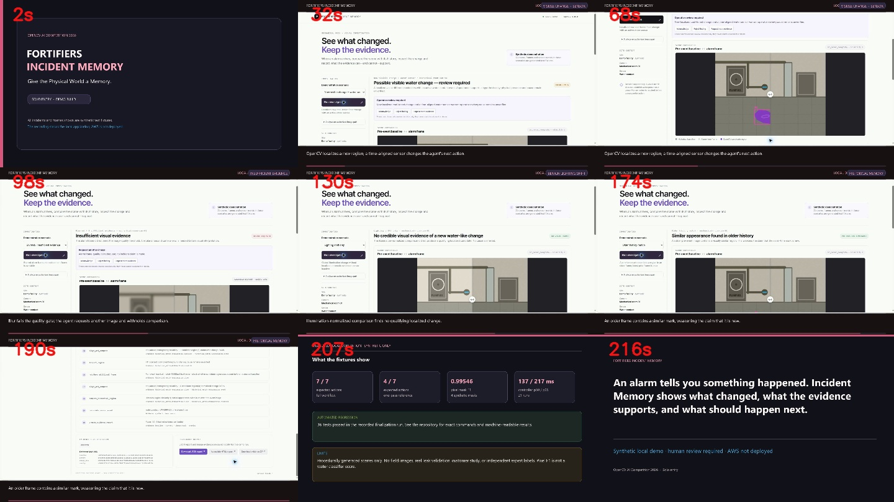

# Fortifiers Incident Memory

**Give the Physical World a Memory.** A local-first, synthetic mechanical-room demo for investigating what visibly changed around an alarm using OpenCV 5 and an observation-driven agent.




Public source repository: https://github.com/axfrgo/fortifiers-incident-memory

Environmental Incident Memory investigates what changed around a physical alarm. It retrieves a pre-event frame, runs real OpenCV 5 image analysis, chooses follow-up actions from those observations, checks older history and sensor timing, and creates a reviewable evidence record. The demo focuses on a synthetic industrial mechanical-room water-sensor event.

> **Honest build status:** local OpenCV 5 processing, API scenarios and tests are verified. AWS and Docker are **not deployed or verified**: no AWS account is authenticated in the console or configured locally, and no AWS resources were created. The AWS tab is at account signup; credits and App Runner eligibility are unknown. There is no public demo endpoint, so this build does not meet the competition's AWS workload and judge-accessible endpoint requirements. The real 3:40 video is published on YouTube as Unlisted and was verified by an unauthenticated HTTP request. See [deployment-manifest.json](deployment-manifest.json), [DEPLOYMENT.md](DEPLOYMENT.md), and [FINAL_SUBMISSION_STATUS.md](FINAL_SUBMISSION_STATUS.md).

All included images and sensor events are procedurally generated synthetic fixtures. The blue/cool-toned patch is a staged visual cue, not actual water and not real-world validation.

## Demonstration video

The recorded silent, captioned walkthrough is in the local workspace at `artifacts/video/fortifiers-incident-memory-demo.mp4`. It is 220.4 seconds (3:40), 1920×1080 at 15 fps; its SHA-256 and recording/render provenance are in [video-manifest.json](artifacts/video/video-manifest.json). It shows the real local application and synthetic incidents. It explicitly discloses that AWS is not deployed and the fixtures are not field validation. [Watch the Unlisted video on YouTube](https://youtu.be/_k0J1XHyVyA). It is also available as a [public GitHub release asset](https://github.com/axfrgo/fortifiers-incident-memory/releases/download/demo-2026-10-27/fortifiers-incident-memory-demo.mp4).

The recording identifies this as a solo entry but does not show or name the entrant. No likeness or voice was fabricated. The entrant may still need to add their own introduction if the judges interpret the team-identification requirement as requiring a named or visible member.

### Synthetic OpenCV output

The baseline, event frame and annotation below are from a real local dashboard investigation over synthetic fixtures. They are not photographs of a deployed facility.

| Pre-event baseline | Alarm-time frame | OpenCV change overlay |
|---|---|---|
|  |  |  |

## Run locally

Verified here with Python 3.14.0, OpenCV 5.0.0.93 and NumPy 2.5.4 on Windows 10. Python 3.11+ is specified in the container configuration, but a Python 3.11 or Docker build was not verified in this workspace.

```powershell
py -3.14 -m venv .venv
.\.venv\Scripts\python.exe -m pip install -r requirements-lock.txt
$env:PYTHONPATH = 'src'
.\.venv\Scripts\python.exe -m uvicorn incident_memory.api:app --host 127.0.0.1 --port 8000
```

Open `http://127.0.0.1:8000`. Select a synthetic scenario and choose **Run investigation**. The dashboard shows a draggable comparison, candidate overlays, time history, actual completed tool trace, evidence classes, report downloads and review controls. `GET /health` must report an OpenCV 5 version.

For a direct check from another PowerShell window:

```powershell
Invoke-RestMethod http://127.0.0.1:8000/health
Invoke-RestMethod http://127.0.0.1:8000/api/investigate/clear_change
```

Local authorized image uploads are available in the interface and limited to PNG/JPEG/WebP, 17 MiB total request size, 8 MiB per image and 12 MP decoded dimensions. OpenCV 5 DNN YuNet blurs detected faces; this does not find every face or other sensitive identifier. Upload processing fails closed if the model or inference is unavailable. Do not upload images without rights/consent or containing unredacted sensitive information. The prepared AWS configuration disables user image uploads.

## Rebuild data, evaluate, test

```powershell
$env:PYTHONPATH = 'src'
.\.venv\Scripts\python.exe scripts\build_dataset.py
.\.venv\Scripts\python.exe scripts\evaluate.py
.\.venv\Scripts\python.exe -m pytest -q --junitxml=artifacts/test-results.xml
.\.venv\Scripts\python.exe scripts\summarize_test_results.py
.\.venv\Scripts\python.exe scripts\export_demo_cases.py
.\.venv\Scripts\python.exe scripts\package_source.py
```

The fresh held-out run selected expected policy actions for 7/7 scenario types versus 4/7 for the simple one-pass comparator. Synthetic pixel-mask precision/recall/F1 were 0.99183/0.99913/0.99546. Controller p50/p95 were 137.061/217.262 ms across 21 runs. These are procedural-fixture measurements, not field leak-detection performance. A fresh local HTTP smoke check returned 200 for the dashboard, health endpoint and four scenarios; its actual traces are in `artifacts/finalization-api-smoke.json`. It is local-only evidence. Earlier overlay/ZIP evidence is in `artifacts/final-local-verification.json` and `artifacts/final-local-clear-change-evidence.zip`. Full results and limitations are in [EVALUATION.md](EVALUATION.md).

The latest local test output is in `artifacts/test-results-finalization.xml` and `artifacts/test-results.json` (36 passed). `artifacts/demo-cases.json` points to synthetic reports, traces and overlays. The portable source archive is `artifacts/fortifiers-incident-memory-source.zip`; its judge-accessible download is [the GitHub release archive](https://github.com/axfrgo/fortifiers-incident-memory/releases/download/demo-2026-10-27/fortifiers-incident-memory-source.zip), with digest and validation details in [source-archive-manifest.json](artifacts/source-archive-manifest.json). A ZIP is attached to the saved Devpost draft as well.

## Deployment

The prepared deployment package uses private ECR, App Runner for the OpenCV 5 API and a private versioned S3 bucket. **Nothing has been created in AWS.** App Runner is closed to new AWS customers, and this account's eligibility is unknown. A later authorized deployment requires a supported AWS service/account, Docker, AWS CLI/role, a selected region and explicit billable-resource approval. See [DEPLOYMENT.md](DEPLOYMENT.md) and `deployment/deploy.ps1`.

## Project map

- `src/incident_memory/vision.py` — OpenCV 5 validation, quality, registration, normalized difference, regions and overlays.
- `src/incident_memory/memory.py` — timestamped camera/context memory and baseline contamination safeguards.
- `src/incident_memory/agent.py` — bounded observation-driven tool policy, trace and evidence report.
- `src/incident_memory/api.py` — local FastAPI UI/API, validated uploads and review record.
- `src/incident_memory/static/` — accessible responsive dashboard.
- `data/synthetic/` — generated tuning/held-out fixtures, masks and manifest.
- `tests/` — vision, memory, agent, API and storage failure tests.
- `submission/` — architecture and workflow SVG diagrams.

See [TECHNICAL_REPORT.md](TECHNICAL_REPORT.md), [RESPONSIBLE_USE.md](RESPONSIBLE_USE.md), [JUDGING_SCORECARD.md](JUDGING_SCORECARD.md), [FINAL_SUBMISSION_STATUS.md](FINAL_SUBMISSION_STATUS.md), and [BUILD_LEDGER.md](BUILD_LEDGER.md). The signed-in Devpost account has a saved private draft, not a submitted entry. The entrant reports entering solo. The AWS endpoint remains outstanding. Submission wording and the recorded-video notes are in [SUBMISSION.md](SUBMISSION.md) and [DEMO_SCRIPT.md](DEMO_SCRIPT.md).

