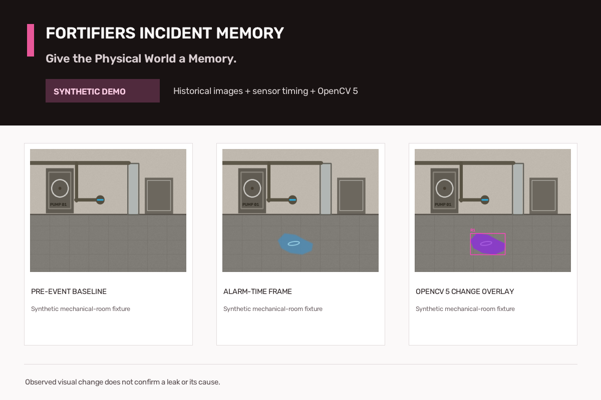
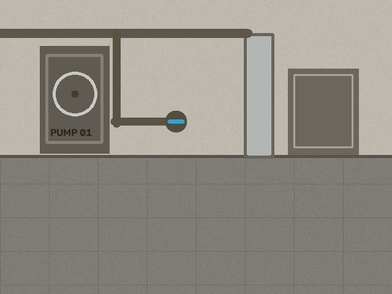
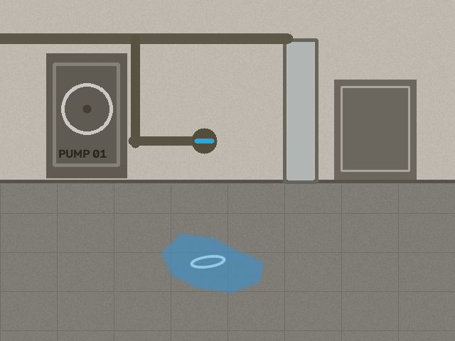
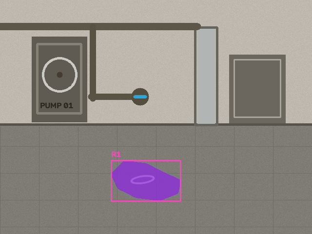

# Fortifiers Incident Memory

**Give the Physical World a Memory.** An event-triggered investigation system that compares alarm-time images with visual history, uses OpenCV 5, and lets observed image results change the next evidence-gathering action.

**Live AWS demo:** https://bxdbra2nzvrrchyig26xr274dm0cvzol.lambda-url.us-east-2.on.aws/
**Public source:** https://github.com/axfrgo/fortifiers-incident-memory
**Unlisted demo video:** https://youtu.be/_k0J1XHyVyA
**Portable archive:** https://github.com/axfrgo/fortifiers-incident-memory/releases/download/demo-2026-10-27/fortifiers-incident-memory-source.zip

## What the demo does

The demonstration focuses on a mechanical room and a simulated water-contact alarm. It retrieves a matching pre-event frame, assesses quality, aligns and compares images using OpenCV 5, inspects candidate regions and sensor timing, retrieves older history when useful, and produces an auditable report for human review. Blurry or obstructed evidence leads to a retake request. A visible change correlated with a synthetic sensor becomes a cautious hypothesis, never a confirmed cause.

All rooms, frames, visual patches, and sensor events are procedurally generated. The results are not real-world leak-detection validation.

## Verified AWS execution

The public dashboard and investigation API run on AWS Lambda in us-east-2. The deployed Python 3.14 ZIP package uses FastAPI/Mangum and OpenCV 5.0.0; health reports commit b851290df9e99aca1a232c018e53bff48b8f559d. All seven remote synthetic scenarios returned HTTP 200 with distinct policy outcomes. The clear-change case returned a nine-step agent trace, human-review outcome, and downloadable evidence ZIP stored privately in S3. CloudWatch logs show actual Lambda invocations, including an investigation invocation using 218 MiB maximum memory.

Public endpoint details, sanitized remote responses, package checksum, safeguards, and teardown steps are in DEPLOYMENT.md and deployment-manifest.json. This is a public unauthenticated synthetic demo, not a production endpoint. User uploads are disabled. Do not submit private images or sensitive data.

## OpenCV and the observation-driven agent

The engine uses OpenCV image validation and quality checks, ORB feature matching with RANSAC homography, ECC translation fallback, HSV illumination normalization, difference masks, morphology, connected components, region measurements and annotation. Its deterministic bounded controller consumes those outputs and changes subsequent tool selection: a poor-quality observation requests a retake; a candidate change triggers ROI inspection and older-history retrieval; matching older evidence downgrades novelty; a sensor-correlated visual candidate requests human review. See AGENT_WORKFLOW.md and submission/agent-workflow.svg.

## Example synthetic visual evidence

| Pre-event baseline | Alarm-time frame | OpenCV annotated change |
|---|---|---|
|  |  |  |

These are generated fixtures, not photographs from a deployed facility. The evaluation summary and case-by-case chart are in [EVALUATION.md](EVALUATION.md) and [artifacts/task-correctness.svg](artifacts/task-correctness.svg).

## Demonstrate

Visit the [live AWS dashboard](https://bxdbra2nzvrrchyig26xr274dm0cvzol.lambda-url.us-east-2.on.aws/), choose a synthetic scenario, and run an investigation. See the real trace, image overlay, evidence classifications, and report links. The remote API evidence is in artifacts/aws-remote-results.json and artifacts/aws-verification/.

The current 3:40 silent/captioned YouTube recording was made before AWS deployment; its end card correctly described the earlier local-only state but is now out of date. It demonstrates the actual local app and synthetic scenarios, not the live AWS endpoint. The video does not show or name the solo entrant. The live AWS endpoint and independently saved cloud evidence are provided above and in the deployment report. No AI-generated team likeness or voice is used.

## Run locally

Verified with Python 3.14.0, OpenCV 5.0.0.93 and NumPy 2.5.4 on Windows 10. The AWS runtime is separately verified as Python 3.14 with OpenCV 5.0.0.

    py -3.14 -m venv .venv
    .\.venv\Scripts\python.exe -m pip install -r requirements-lock.txt
    $env:PYTHONPATH = 'src'
    .\.venv\Scripts\python.exe -m uvicorn incident_memory.api:app --host 127.0.0.1 --port 8000

Open http://127.0.0.1:8000. Choose a synthetic scenario and run the investigation.

    Invoke-RestMethod http://127.0.0.1:8000/health
    Invoke-RestMethod http://127.0.0.1:8000/api/investigate/clear_change

Local authorized uploads accept PNG/JPEG/WebP and enforce request, per-image, resolution and decoded-pixel limits. OpenCV 5 YuNet face blurring is not comprehensive redaction. The public AWS deployment disables all user image uploads.

## Tests and evaluation

The latest complete automated suite passed 37/37 tests (one existing Starlette/AnyIO deprecation warning). The current portable source archive contains 232 files and remains below Devpost's 35 MB limit; it excludes the Lambda runtime ZIP and virtualenv, passes ZIP integrity checks, and was extracted and tested: 37 passed, 0 failed, 0 skipped using the pinned Python/OpenCV environment. The archive checksum and included validation are recorded in artifacts/source-archive-manifest.json. See artifacts/aws-fix-tests.xml and artifacts/test-results.json.

On seven procedurally generated held-out scenario types, the full policy selected the test-authored expected action in 7/7 types; a simple one-pass comparator did so in 4/7. Synthetic pixel-mask precision/recall/F1 were 0.99183/0.99913/0.99546. Controller p50/p95 were 137.061/217.262 ms across 21 local runs. These metrics describe generated fixtures and local execution only; they do not estimate field performance, physical water detection, or AWS latency. See EVALUATION.md for methods and failure cases.

To reproduce:

    $env:PYTHONPATH = 'src'
    .\.venv\Scripts\python.exe scripts\build_dataset.py
    .\.venv\Scripts\python.exe scripts\evaluate.py
    .\.venv\Scripts\python.exe -m pytest -q --junitxml=artifacts/test-results.xml
    .\.venv\Scripts\python.exe scripts\package_source.py

## Documentation

- TECHNICAL_REPORT.md — problem, users, OpenCV and AWS implementation, evaluation, limits.
- ARCHITECTURE.md and submission/architecture.svg — runtime architecture.
- AGENT_WORKFLOW.md and submission/agent-workflow.svg — observation/action traces.
- EVALUATION.md — reproducible synthetic results and failure cases.
- RESPONSIBLE_USE.md — classifications, human control, privacy and limits.
- DEPLOYMENT.md and deployment-manifest.json — real AWS configuration and verification.
- JUDGING_SCORECARD.md — rubric evidence and remaining gaps.
- SUBMISSION.md and DEMO_SCRIPT.md — ready-to-review Devpost wording and video notes.
- FINAL_SUBMISSION_STATUS.md — current release and submission status.
- BUILD_LEDGER.md — timestamped execution record.
- LICENSES_AND_DATA_PROVENANCE.md — source and fixture provenance.

The signed-in entrant has a saved private Devpost draft. It has not been submitted. Final eligibility declarations and submission remain the entrant's responsibility.
